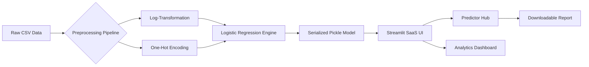

# 📡 Customer Churn Prediction

### **Precision Customer Retention Powered by Inferential Intelligence**


---

## 📖 Overview

**ChurnAI** is an industry-grade predictive analytics platform designed to bridge the gap between complex machine learning and actionable business strategy. In a subscription-based economy, customer churn is the "leaking bucket" that drains revenue; ChurnAI plugs that leak by identifying at-risk accounts with **80% recall accuracy** before they depart.

This project goes beyond simple "black-box" predictions. It integrates **rigorous inferential statistics**—including Welch’s T-Tests and Chi-Square Contingency analysis—to provide a transparent, evidence-based view of customer behavior.

Whether you are a Retention Manager looking for a "What-If" simulation tool or a Data Engineer seeking a robust Scikit-Learn pipeline, ChurnAI offers a production-ready interface to turn raw data into retention ROI.

---

## 💎 Core Value Proposition

| Feature | Benefit |
| :--- | :--- |
| **80% Recall Model** | Prioritizes catching every potential leaker over false alarms. |
| **SaaS Dark Mode UI** | Modern, card-based dashboard designed for executive presentations. |
| **Statistical Validation** | Every feature is vetted via P-value significance $(\alpha = 0.05)$. |
| **Automated Reporting** | Instant, timestamped risk reports for immediate stakeholder action. |

---

## 🏗️ Architecture Overview



### **Architectural Highlights**
* **Atomic Serialization:** The entire preprocessing logic and trained coefficients are bundled into a single `.pkl` file for zero-config deployment.
* **Log-Normal Calibration:** Explicitly handles right-skewed financial data ($TotalCharges$) to ensure linear model stability.
* **Responsive Input Hub:** Separates high-correlation drivers from secondary demographics via UI nesting.

---

## 🛠️ Technical Deep Dive

### **Core Components**
| Component | Technology | Role |
| :--- | :--- | :--- |
| **Modeling** | `LogisticRegression` | Interpretable binary classification with balanced class weights. |
| **Statistics** | `SciPy Stats` | Hypothesis testing (T-test, $\chi^2$) for feature importance. |
| **Frontend** | `Streamlit` | Custom CSS-injected wide-layout SaaS interface. |
| **Persistence** | `Joblib` | Efficient serialization of the Scikit-Learn pipeline. |

### **Security & Safety**
* **Input Validation:** Strict `dtype` coercion on numeric inputs to prevent runtime crashes.
* **Environment Isolation:** Optimized for `venv` deployment with pinned dependencies.

---

## ✨ Key Features

* **🔍 Interactive Predictor:** Dynamic sliders and selectors for the most correlated churn drivers (Tenure, Contract, Charges).
* **📊 Business Analytics Hub:** Visualizes the "Danger Zone" (0-6 month tenure) and contract-based risk segmentation.
* **🛠️ Advanced Simulation:** Nested expanders allow power users to modify 20+ variables for deep-dive "What-If" scenarios.
* **📥 One-Click Export:** Generates professional, internal-use-only text reports with probability metrics and action items.
* **🎨 SaaS Aesthetics:** Custom CSS hover effects, soft shadows, and a consistent deep-space color palette.

---

## 📂 Project Structure

```text
Customer_Churn_Prediction/
├── data/
│   └── Telco_Customer_Churn.csv   # Raw dataset
├── models/
│   └── churn_model_v1.pkl         # Serialized ML Pipeline
├── notebooks/
│   └── analysis.ipynb             # Statistical & ML Training Lab
├── src/
│   └── app.py                     # Main Streamlit SaaS Application
├── requirements.txt               # Dependency Manifest
└── README.md                      # Professional Documentation
```

---

## ⏱️ Quick Start

### **1. Clone & Navigate**
```bash
git clone https://github.com/KrishKamra/Customer_Churn_Prediction.git
cd Customer_Churn_Prediction
```

### **2. Setup Environment**
```bash
python -m venv churn_env
source churn_env/bin/activate  # Windows: churn_env\Scripts\activate
pip install -r requirements.txt
```

### **3. Launch the Dashboard**
```bash
streamlit run src/app.py
```

---

## 🗺️ Roadmap

- [x] Phase 1: Statistical Hypothesis Testing (T-Tests/Chi-Square)
- [x] Phase 2: Full-Stack Scikit-Learn Pipeline Serialization
- [x] Phase 3: SaaS Dashboard UI with Dark Mode
- [ ] Phase 4: Integration with SQLite/PostgreSQL for live customer lookups
- [ ] Phase 5: Implementation of SHAP values for local explainability

---

## 👨‍🔬 Author

**Krish Kamra**

---

## 📄 License

Distributed under the MIT License. See `LICENSE` for more information.

---